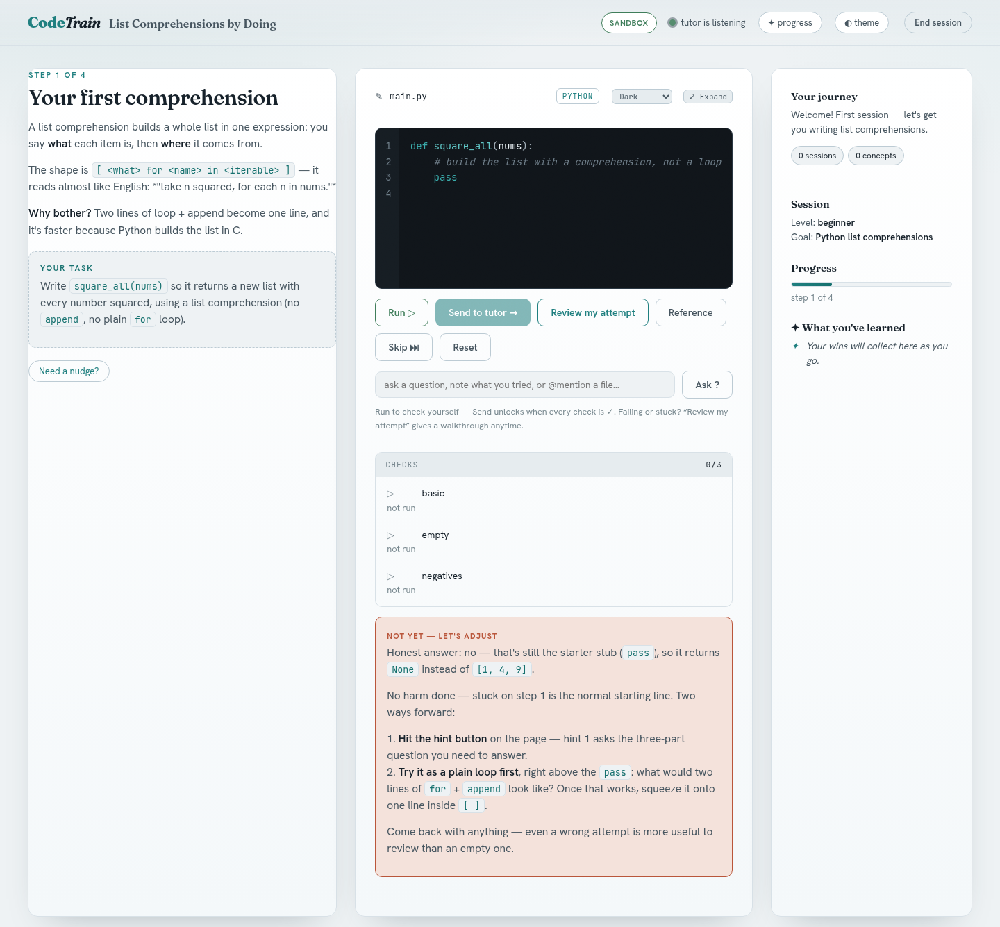

# CodeTrain: an open-source Socratic coding tutor

This repository holds open agent skills from [InferHaven](https://inferhaven.com). Today it holds one skill, CodeTrain, in the folder `codetrain/`.

## CodeTrain, the Socratic coding tutor

CodeTrain Open Skill is an open-source Socratic coding tutor that runs as an Agent Skill inside your own coding agent. It is free, Apache 2.0 licensed, and uses the coding agent and model account you already have. There is no CodeTrain account and nothing is sent to CodeTrain.

You write every line. Your agent sets small steps, gives hints, and reviews what you wrote, and it never puts the solution into the lesson. If you want the answer written for you, you can ask your agent directly in its own chat; that is your choice and it is never refused there.

A lesson happens on a small local web page with an editor, a Run button that checks Python and JavaScript against test cases in your browser, and a Send button that hands your code to your agent for review. The tutor can also turn a diff, a commit, a branch or a GitHub pull request into a lesson where you rewrite each change.



*A real lesson page from the OpenCode test run; the lesson text was written by the model that test used.*

Install with the skills CLI:

```bash
npx skills add InferHaven/agent-skills --skill codetrain
```

Without `--skill`, the command above lists every skill in this repository and installs the ones you pick. With `-y`, or when an AI coding agent runs it (the CLI detects Claude Code, OpenCode, Cursor, Codex, Antigravity and others), it skips the list and installs every skill. Use `--skill <name>` to install only the skills you name, several names for several, or `--skill '*'` for all of them.

`npx skills add` runs the skills CLI from npm, which needs Node.js 22.20 or later. Check yours with `node --version`; on an older Node.js, the `git clone` commands install the same skill into `~/.claude/skills/codetrain` and need no Node.js at all.

Or clone the repository and run `./install.sh` in `codetrain/`:

```bash
git clone https://github.com/InferHaven/agent-skills
cd agent-skills/codetrain
./install.sh
```

After installing, restart your agent and ask, for example, "teach me this code" or "give me a practice exercise on recursion". You need `python3` and a web browser. The full README has the details: [codetrain/README.md](./codetrain/README.md).

## Where it was tested

Tested 2026-10-06 with the final version of CodeTrain Open Skill, each from a plain request, every stage passing without a nudge: Claude Code 2.1.291; OpenCode 1.18.34, which asks before your agent uses `/tmp/codetrain-*`, where lessons live, so allow it; and Antigravity CLI 1.3.0 with its default model. Codex CLI 0.128.0 was tested earlier the same day with the previous version and a small model: it started only when CodeTrain Open Skill was named and after one "check it", and it did not review submitted code. Cursor, GitHub Copilot and Gemini CLI were not tested.

Claude Code wakes the tutor by itself when you press Send. In an agent that does not, type "check it" in your agent's chat after Send. The full per-agent table is in [codetrain/README.md](./codetrain/README.md).

## CodeTrain

CodeTrain is one product with one account, and it is not open source. The CodeTrain CLI and the CodeTrain website are two ways into it: the CodeTrain CLI is a free install that needs a CodeTrain account and talks to CodeTrain's service, and the CodeTrain website is at [codetrain.ai](https://codetrain.ai). CodeTrain has a free plan, 10 lessons a month with no card, and paid plans.

CodeTrain Open Skill is single-player and uses your own agent. The CodeTrain plans add managed models with no setup, cross-device profile sync, and team features. If that is what you need, [pricing is here](https://codetrain.ai/#pricing).

## License

CodeTrain Open Skill is licensed under the Apache License 2.0; see [LICENSE](./LICENSE) and [NOTICE](./NOTICE). Contributions are accepted under the Developer Certificate of Origin; there is no CLA. The repository is published by InferHaven LLC.
